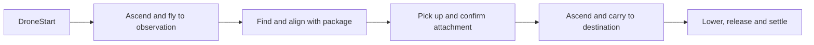
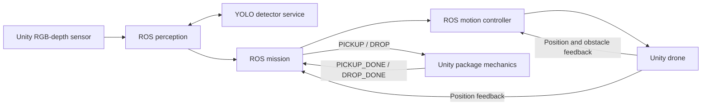

# Drone Sorting Project

One warehouse demo: a drone finds a package with an RGB-depth camera, picks it up,
and delivers it to a sorting zone. **ROS owns the mission and movement; Unity owns
simulation, sensors, package physics, and rendering.**

This branch also includes a standalone two-warehouse Unity delivery. See the
[Unity branch handoff](Unity/BRANCH_HANDOFF.md) for completed work, changed files,
test evidence, limitations and how to run it. The ROS instructions below use the
original `MainWarehouse` demo.

## Run the demo

Use a **host terminal**, outside the ROS container, without `sudo`. Run the commands
from the **repository root**: the folder containing `README.md`, `ROS1/` and `Unity/`.

| When | Script to run |
| --- | --- |
| First setup or dependencies changed | `bash ROS1/scripts/setup_demo.sh` |
| Every run or restart | `bash ROS1/scripts/run_demo.sh` |

### First-time setup

Install the [requirements](#installation) first. The
[Setup and troubleshooting guide](docs/setup-and-troubleshooting.md) covers ROS/Distrobox
installation, custom Unity/Python paths, optional GPU inference and startup problems.

For a new checkout:

```bash
git lfs install
git clone https://github.com/Dzzz83/DroneSortingProject.git
cd DroneSortingProject
git lfs pull
bash ROS1/scripts/setup_demo.sh
```

For an existing checkout, enter its root and run `git lfs pull`, then
`bash ROS1/scripts/setup_demo.sh`.

Setup creates the detector environment, verifies the included model, and builds
the ROS workspace. It does not install Unity or system packages.
Wait for `[OK] Setup complete`.
Rerun setup after dependencies change, with the demo stopped. No training is needed.

### Run or restart

Open a host terminal and enter your checkout (replace `/path/to/DroneSortingProject`
with its actual location). Save Unity edits first: the runner closes this project's
previous demo editor.

```bash
cd /path/to/DroneSortingProject
bash ROS1/scripts/run_demo.sh
```

The runner builds the ROS workspace, opens `MainWarehouse`, and starts ROS and
YOLO. You do not need to run individual nodes or scripts in `scripts/internal/`.
Wait for **`[READY]`**, then press **Play** in Unity. Keep the launcher terminal open
and the **Game** view available. The saved scene is `Unity/Assets/Scenes/MainWarehouse.unity`.

### Stop and retry

Stop Play in Unity, then press **Ctrl+C** in the launcher terminal to stop ROS and
YOLO. Unity stays open. Save any edits, then use the same run command above to
start a fresh attempt.

## Installation

| Requirement | Supported setup |
| --- | --- |
| Host | x86-64 native Linux with a working graphics driver |
| Unity | Activated Editor **6000.6.0f1** |
| ROS | **Noetic**, native on Ubuntu 20.04 or in Distrobox `ros-noetic` |
| Python | Host Python **3.11** with `venv`/`pip`, plus host `python3` |
| Tools | Git + Git LFS, Bash, `flock`, `realpath`, `sha256sum`; OpenCV GL/GLib libraries |

Unity and the detector run on the host. Noetic is end-of-life; Windows/WSL is not
supported by these launch scripts. See [Setup and troubleshooting](docs/setup-and-troubleshooting.md)
for ROS/container installation and executable overrides.

## Workflow



Check that the package is physically carried and rests inside the destination.
`COMPLETE` alone does not prove correct placement or collision-free travel.
A mission performs one delivery; repeated cycles and automatic failure recovery
are not implemented.

| Spectator camera control | Action (click the Game view first) |
| --- | --- |
| Right mouse, held | Enter free flight and look around |
| WASD; Q/E | Move; move down/up while holding right mouse |
| Shift | Move faster while holding right mouse |
| Release right mouse / Esc | Release cursor; leave view in place |
| F | Return to drone-follow view |

Free flight can pass through geometry. It does not move the drone or its sensor camera.

## What to change and where

Edit the **source** files below, not copies under `ROS1/build/`. Restart the demo
after ROS configuration changes. Stop Play before editing Unity and save the scene.

| I want to… | Edit here | What to change |
| --- | --- | --- |
| Move the delivery destination | [config/demo.yaml](ROS1/package/config/demo.yaml), `camera_pickup` | `dropoff_x`, `dropoff_y`; `carry_height` and `release_height` refer to the **drone root** |
| Move the visible destination zone | `SortingZoneAVisual` and `SortingZoneA` in the Unity Hierarchy | Move both to match the ROS destination; changing YAML does not move these objects |
| Change the starting position | `DroneStart` in `MainWarehouse`, and the drone transform | `DroneStart` is a scene marker; the mission starts from the drone's reported position |
| Change drone speed | [Demo settings](#demo-settings), `camera_pickup` | Separate speeds for travel, approach, descent, lift and lowering; `motion_controller.speed` sets the ceiling |
| Change the observation point or flight heights | [config/demo.yaml](ROS1/package/config/demo.yaml), `camera_pickup` | `observation_x`, `observation_y`, `observation_height`, `carry_height`, `release_height` |
| Change the package search area | Same YAML, `package_perception` | `pickup_bounds`: `[min X, max X, min Y, max Y]`; `surface_height_range` filters package tops |
| Change obstacle avoidance and feedback limits | Same YAML, `motion_controller` | `enable_obstacle_avoidance`, speed, stale-feedback timeouts and `maximum_command_lead` (metres) |
| Change the warehouse viewing camera | Select **Player → CinemachineCamera**, then **SpectatorCamera** in the Inspector | Follow view position, distance, focus offset, smoothing and free-camera speed; implementation: [SpectatorCamera.cs](Unity/Assets/Scripts/Warehouse/SpectatorCamera.cs) |
| Change the drone's perception camera | [DroneRgbCamera.cs](Unity/Assets/Scripts/Sensors/DroneRgbCamera.cs) | Mount position/rotation and lens/resolution defaults; this camera is created under `PackageRgbCamera` at Play |
| Change pickup/drop mechanics | [PackageHandling.cs](Unity/Assets/Scripts/Packages/PackageHandling.cs), drone/package prefab Inspectors | Detection range, package mount, gripper and attachment/release behavior |
| Change package placement or warehouse geometry | `MainWarehouse` scene; prefabs under `Unity/Assets/Prefabs/` | Edit saved scene objects or prefab assets, preserving required component references |
| Change detector/model behavior | [detector.py](ROS1/tools/detector.py), [model notes](ROS1/models/README.md) | Inference settings; model override and GPU settings are in the advanced guide |

**Coordinates:** metres; Unity `(X, Y, Z)` becomes ROS `(X, Z, Y)`. Unity **Y** and
ROS **Z** are vertical. For example, ROS destination `(12, 55)` lies at Unity
horizontal `(X=12, Z=55)`. Changing flight targets does not generate a new safe route;
check warehouse obstacles and package clearance.

### Demo settings

[ROS1/package/config/demo.yaml](ROS1/package/config/demo.yaml) is the main file for
ROS demo tuning. Edit it directly; ordinary tuning does not require changing
Python code or rerunning setup. Its three sections control:

| YAML section | What you can change |
| --- | --- |
| `camera_pickup` | Mission: destination, observation point, heights, speeds, pickup tolerances and phase timeouts |
| `motion_controller` | Movement: maximum speed, obstacle avoidance, feedback timeouts and command-lead limit |
| `package_perception` | Vision: package search bounds, accepted surface heights and maximum observation age |

All speeds below are **metres/second**, under `camera_pickup`:

| Parameter | Movement stage |
| --- | --- |
| `access_speed` | Ascend and fly to the observation point |
| `approach_speed` | Align above the selected package |
| `descent_speed` | Descend to pick it up |
| `lift_speed` | Lift immediately after attachment |
| `carry_speed` | Ascend to carry height and transport the package |
| `lowering_speed` | Lower at the destination before release |

For example, use **1 m/s** for the long flights by editing these existing values
(keep the rest of the YAML file):

```yaml
camera_pickup:
  access_speed: 1.0
  carry_speed: 1.0

motion_controller:
  speed: 1.0
```

`motion_controller.speed` is the **maximum allowed speed**, not a multiplier.
Every requested mission speed must be at or below it; higher requests are rejected
and stop movement. Keep `enable_dynamic_speed: true` so the mission selects each
stage's speed. Start by changing access/carry speeds while keeping pickup and
lowering slower.

`maximum_command_lead` is a distance limit, not a speed. If the controller logs
`WAIT_FOR_FEEDBACK`, it is waiting for Unity's reported position to catch up;
raising a requested speed alone may not increase actual movement speed.

To apply changes: stop Play, press **Ctrl+C** in the launcher, save Unity edits,
edit the YAML, then run `bash ROS1/scripts/run_demo.sh`. Wait for `[READY]` and
press Play. Verify obstacle avoidance, pickup and final placement at the new speeds.

## Project Structure

| Location | Responsibility |
| --- | --- |
| `ROS1/scripts/{setup_demo,run_demo}.sh` | The two supported user commands |
| `ROS1/scripts/internal/` | Environment selection, workspace build and ROS supervision |
| `ROS1/package/config/demo.yaml` | Supported mission, controller and perception tuning |
| `ROS1/package/launch/` | Start ROS nodes and TCP endpoint; load configuration |
| `ROS1/package/nodes/` | Thin ROS entry points; `monitor.py` prints terminal status |
| `ROS1/package/python/drone_sorting/` | Actual mission, control and perception implementation |
| `ROS1/tools/` | Detector service, scoped process cleanup and memory check |
| `ROS1/tests/` | Regression tests; keep these with the source |
| `ROS1/models/`, `requirements/` | Included checkpoint/provenance and detector dependencies |
| `Unity/Assets/Scenes/`, `Prefabs/` | Saved warehouse scene, drone and package |
| `Unity/Assets/Scripts/` | Unity code, grouped by responsibility below |
| `Unity/Assets/Editor/DemoLauncher.cs` | Opens and validates the saved scene; waits for editor readiness |
| `Unity/Assets/UnityWarehouseSceneHDRP/` | Imported warehouse models, materials, lighting and decorative shelf script |
| `Unity/Assets/{Settings,Materials,DroneDelivery,TextMesh Pro,Shaders,Resources}/` | Rendering settings/materials, text shaders, depth shader and ROS connection prefab |
| `Unity/Packages/`, `ProjectSettings/` | Dependency versions and Unity project settings |
| `ROS1/build/`, `Unity/Library/` | Ignored generated dependencies/workspace/logs and Unity import cache |
| `docs/setup-and-troubleshooting.md` | Linux environment setup, executable overrides and troubleshooting |

The Catkin package is separate from `build/` to prevent ROS resource searches
following generated workspace symlinks back into the package.

## Main Components

| ROS module under `ROS1/package/python/drone_sorting/` | Responsibility |
| --- | --- |
| `mission/delivery.py` | ROS transport: read settings, receive feedback, publish targets/actions/state |
| `mission/delivery_guidance.py` | Observation access, carry, lower, release and settling |
| `mission/pickup_guidance.py` | Select/track a package, align, descend, request pickup and lift |
| `control/motion_controller.py` | One controller: absolute position commands at 20 Hz, avoidance, stale-data stops and bounded command lead |
| `perception/package_perception.py` | Synchronize camera inputs, call detector and publish candidates |
| `perception/camera_validation.py`, `camera_geometry.py` | Validate camera data and convert image/depth coordinates |
| `perception/package_localization.py`, `package_grasp.py` | Locate packages in the warehouse and estimate grasp readiness |
| `interfaces/ros_topics.py` | ROS topic names; keep aligned with Unity's `DroneRosTopics.cs` |

| Unity scripts under `Unity/Assets/Scripts/` | Responsibility |
| --- | --- |
| `Warehouse/WarehouseBootstrap.cs`, `WarehouseSetup.cs` | On Play, wire ROS/sensors, configure the saved spectator and make the drone kinematic |
| `Warehouse/SpectatorCamera.cs` | Human viewing camera: follow and free flight |
| `ROS/DroneCommandSubscriber.cs`, `DroneStatePublisher.cs` | Apply ROS movement commands and report position |
| `ROS/DroneObstacleSensorPublisher.cs` | Seven distances: front, upper-front, lower-front, left, right, up, down; `-1` means clear within range |
| `Sensors/DroneRgbCamera.cs` | Drone sensor mount and lens |
| `Sensors/RgbDepthCapture.cs`, `RgbDepthFrame.cs` | Capture synchronized RGB/metric depth and hold frame data |
| `ROS/DroneCameraPublisher.cs`, `DroneCameraMessages.cs` | Publish image, calibration, poses and transforms |
| `ROS/PackageActionBridge.cs`, `DroneRosTopics.cs` | Translate ROS package actions/confirmations; shared topic names |
| `Packages/PackageHandling.cs`, `GripperController.cs` | Detect nearby packages, move jaws and manage pickup/drop |
| `Packages/DeliveryPackage.cs`, `DeliveryRotor.cs` | Attachment/release physics and rotor visuals |

The warehouse is a **saved scene**, not generated by a scene-builder script.
Some components are installed when Play begins, so they appear only at runtime.

## Current Data Flow



| ROS topics | Data / purpose |
| --- | --- |
| `/drone/{current_position,target_position,command_position}` | `geometry_msgs/Point`: feedback → mission target → applied movement |
| `/drone/command_speed`, `/drone/travel_heading` | `Float32` speed and `Vector3` sensor heading |
| `/drone/obstacle_distances` | `Float32MultiArray`, ordered seven-sensor distances |
| `/drone/{package_action,package_action_status}` | `String` pickup/drop requests and physical-operation confirmations |
| `/drone/{mission_state,pickup_trial_status}` | `String` public mission state and detailed guidance JSON |
| `/drone/camera/{rgb/image_raw,depth/image_raw,camera_info,pose}` | RGB8, metric 32FC1 depth, calibration and camera pose |
| `/drone/current_pose`, `/tf`, `/drone/package_candidates` | Drone pose, transforms and perception JSON |

Runtime node names `camera_pickup` and `package_perception` match the YAML sections.
They are ROS identities; the readable entry points are `mission.py` and `perception.py`.

## Verification

Stop the demo before tests; launcher tests bind demo ports. In a sourced Noetic shell
(enter `distrobox enter ros-noetic` first if needed), change to this checkout and run:

```bash
source /opt/ros/noetic/setup.bash
PYTHONPATH="$PWD/ROS1/package/python:$PWD/ROS1/tools:$PYTHONPATH" \
  /usr/bin/python3 -m unittest discover -s ROS1/tests
```

Host Python skips ROS-dependent checks. For Unity changes, compile in the editor,
then run ROS and Unity together and inspect physical pickup and placement.

## Current Status

One supported warehouse scene, one motion controller and two public scripts.
General route planning, repeated deliveries and automatic recovery are unfinished.
Two consecutive local ROS/Unity runs completed physical pickup, carry, release and
settling inside the destination zone at a carry speed of **0.5 m/s**. Carry took
about 110 seconds in each run, within the 120-second limit. Those checks cover the
saved route at that speed.

A later [laptop AI feasibility probe](docs/avoidance-feasibility.md) completed one
existing delivery at 1 m/s with GPU package inference and a temporary forward
camera/inference load stage. The package was recorded released and stationary
inside the destination. This qualifies a lightweight perception prototype in the
current scene; it does not validate obstacle avoidance or the proposed larger
course. The probe did not change the saved scene or supported demo configuration.

The controller retains its command trajectory between feedback updates and waits
if commands would lead Unity's reported position by more than `maximum_command_lead`.

| Symptom | Check |
| --- | --- |
| Missing camera data before Play | Expected; press Play. If it persists, check Game view and Unity Console |
| Mission fails or holds | Read terminal guidance reason, `monitor.log`, ROS logs and Unity Console; stop Play and restart |
| Unity/Python missing, occupied ports, slow startup | [Setup and troubleshooting](docs/setup-and-troubleshooting.md) |

Each run prints `ROS1/build/camera-demo-*/`. Logs separate Unity (`unity.log`),
inference (`detector.log`), mission (`monitor.log`), build (`build.log`) and ROS
(`ros-logs/`). The next launch removes completed runs, preserves live logs, and
moves Unity recovery scenes to `Unity/UserSettings/SceneBackups/`. Keep
`Unity/Library/` to avoid full reimports. Save intentional edits before restarting.
